<!-- Cards are rendered by scripts/render_cards.py. Edit the config at the top of
     that script, not the SVGs; everything between the markers is regenerated daily. -->
<!-- cards:start -->

  

  
  
  

  

  

  

  

  

  

<!-- cards:end -->
